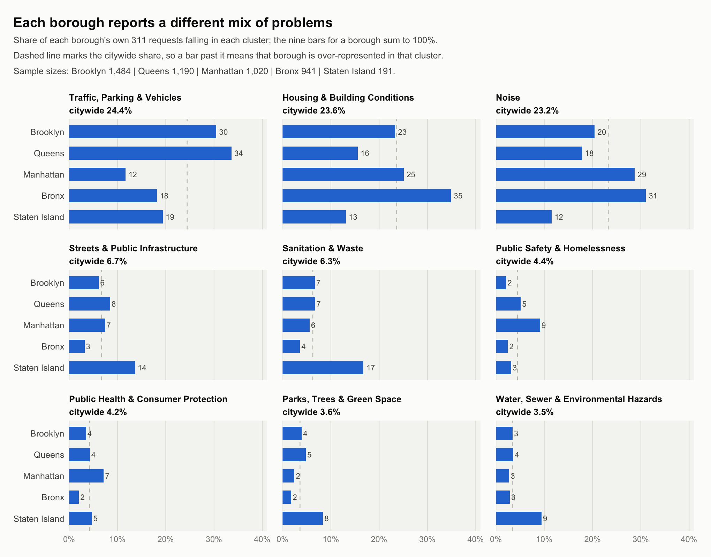

# NYC 311: what a service-request dataset says, and what it only appears to say

Descriptive analysis of ~4,800 New York City 311 service requests, written around a
simple discipline: before reporting a number, work out what the dataset is actually
capable of supporting.

The assignment that produced this supplied working R code and asked what was wrong
with it. Three of the four scripts here began as corrections.



## Four bugs that produce plausible-looking charts

Each of these runs without error and yields a chart you would believe.

| The bug | What it does to the answer |
|---|---|
| `filter(days_to_close <= 7)` **before** grouping, then `n / sum(n)` | Turns "share of each borough's requests resolved in 7 days" into "share of all fast resolutions that happened in this borough" — a completely different quantity that still sums to 100%. |
| No floor on `days_to_close` | Three records close *before* they were created. Negative durations pass a `<= 7` filter silently. |
| Mean of `complaint_type` means, then mean of those | Grouping by borough **and** complaint type first gives every complaint type equal weight regardless of volume, so a two-case category moves the borough average as much as a 400-case one. |
| `group_by(month, .drop = FALSE)` over two years | Collapses January 2024 and January 2025 into one "Jan". A 24-month series is silently reported as 12 months. |

The corrected versions are in `src/`, each with the reasoning in its header.

## What the data supports

**Resolution within seven days is similar across boroughs — 78% to 83%.** The
denominator matters: every logged request counts, so requests never closed count as
not resolved. Confidence intervals are on the figure, and the boroughs overlap.

**Mean resolution time is not a safe summary.** Citywide the median is 0.25 days and
the mean 12.5 days. That gap is the whole story — a long right tail of cases open for
months. The intervals are bootstrap percentile intervals rather than normal-theory
ones, because the distribution is nowhere near normal. And 78 requests never closed at
all: they have no resolution time, they are necessarily excluded, and they are almost
certainly the slowest cases, so **every mean here is optimistic**.

**Monthly volume moves more than sampling noise.** These are counts within a sample,
not citywide volume, so the obvious objection is that the month-to-month movement is
an artefact. It is not: variance/mean is 7.1 against 1.0 expected under Poisson
sampling (χ² = 162.3 on 23 df, p < 2e-16).

**Boroughs report genuinely different problems.** 123 distinct complaint types are
grouped into nine policy-relevant clusters. The Bronx is the most housing- and
noise-dominated borough (35% and 31% of its requests); Queens is the most
vehicle-dominated (34%); Staten Island reports sanitation at 17% against a citywide
6.3%. Shares are within-borough so boroughs of very different size stay comparable,
and each panel carries a citywide reference line, so "is this borough
over-represented?" is answered by position rather than by comparing panels.

## The taxonomy, and why it fails loudly

`src/cluster_complaint_types.R` maps **all 123** distinct complaint types — not a
sample, not the top *n*. Assignments were made by reading each type's handling agency
alongside its most common `descriptor` and `location_type`, which is what
disambiguates labels that are useless on their own. `complaint_type` is case-sensitive
in this data: HPD writes its housing codes in caps (`PLUMBING`, `ELEVATOR`) while DOB
uses title case, and treating those as the same string is its own bug.

The script **stops with an error** if any complaint type in the data is unmapped, or
if the mapping names a type that does not exist. That guard is the point. A mapping
that silently drops unrecognised values degrades quietly every time the data is
refreshed; one that fails loudly cannot.

## Running it

```bash
Rscript src/resolution_by_borough.R            # share resolved within 7 days
Rscript src/mean_resolution_time_by_borough.R  # mean resolution time, bootstrap CIs
Rscript src/monthly_requests.R                 # monthly volume, Jan 2024 - Dec 2025
Rscript src/cluster_complaint_types.R          # build the 123-type taxonomy
Rscript src/cluster_mix_by_borough.R           # cluster mix, by borough

python3 src/resolution_by_borough.py           # Python twin of the first script
```

Requires `readr`, `dplyr`, `lubridate`, `ggplot2`, `scales`; and `pandas`,
`numpy`, `matplotlib` for the Python version. Run from the repository root.

The Python and R versions of the resolution-by-borough analysis are independent
implementations of the same definition and agree to the percentage point — which is
the only reason to keep both.

```
data/    nyc_311_sample.csv                   ~4,800 requests
         complaint_type_clusters_revised.csv  the reviewed 123-type mapping
src/     five R scripts and one Python script
output/  figures and the derived files
docs/    the submitted assignment
```

## Data

A ~4,800-record sample of NYC 311 service requests covering January 2024 to December
2025, from [NYC Open Data](https://data.cityofnewyork.us/Social-Services/311-Service-Requests-from-2010-to-Present/erm2-nwe9).
All records fall inside the window and all 24 months are complete, so no partial month
distorts either end of the series.

Counts are of a sample, not of citywide volume. Levels should not be read as New York
City totals; the comparisons between boroughs and across months are the part that
carries.

## Context

Coursework for **API-232: Computational Policy Analysis**, Harvard Kennedy School,
Fall 2026 (Assignment 1).
